# INSTITUTO DE EDUCACIÓN SUPERIOR TECNOLÓGICO PÚBLICO
## "PEDRO P. DÍAZ"

### LABORATORIO N.° 08
#### API CRUD en Laravel — Gestión de Notas (API REST sin autenticación)

| | |
|---|---|
| **Carrera profesional** | Desarrollo de Sistemas de Información |
| **Módulo formativo** | Programación de Sistemas de Información |
| **Unidad didáctica** | DESARROLLO WEB INTEGRADO |
| **Estudiante** | Juan José Condori Bolívar |
| **Semestre** | IV |
| **Año académico** | 2026 |

---

## 1. Objetivos

- Desarrollar una API REST que atienda las peticiones CRUD (Create, Read, Update, Delete) utilizando el framework Laravel.
- Construir un servicio *backend puro*, que no genera vistas sino que devuelve y recibe datos en formato JSON, para que pueda ser consumido por cualquier otro sistema (Angular, React, una app móvil, etc.).
- Aplicar los verbos HTTP principales (`GET`, `POST`, `PUT`, `DELETE`) y los códigos de estado correspondientes a cada operación.
- Probar cada operación de la API con la extensión **Thunder Client** de Visual Studio Code y documentar los resultados con capturas.

---

## 2. Temas tratados

API CRUD básico en Laravel: modelo y migración (Eloquent), controlador de recurso, validación mediante *Form Request*, rutas de API, respuestas JSON con códigos de estado HTTP y pruebas de endpoints.

---

## 3. Marco teórico: API REST

Una **API** (*Application Programming Interface*) es un conjunto de reglas bien definidas que especifican formalmente la comunicación entre dos componentes de software. Una API **REST** (*Representational State Transfer*) es una API que se ajusta a los límites de la arquitectura REST: comunicación cliente-servidor, **sin estado** (cada petición es independiente de las demás), orientada a **recursos** y con una URL como identificador único de cada recurso. REST no es un protocolo ni un estándar, sino un conjunto de límites de arquitectura que cada desarrollador implementa a su manera.

En una API REST, la **URL representa el recurso** (por ejemplo `/api/nota`), el **verbo HTTP representa la operación** y el **código de estado HTTP representa el resultado**. Los verbos y códigos utilizados en este laboratorio fueron:

| Verbo HTTP | URL del recurso | Acción | Código de estado devuelto |
|---|---|---|---|
| `GET` | `/api/nota` | Obtener la lista de notas | 200 OK |
| `GET` | `/api/nota/{id}` | Obtener el detalle de una nota | 200 OK / 404 Not Found |
| `POST` | `/api/nota` | Crear una nota nueva | 201 Created / 422 Unprocessable Content |
| `PUT` | `/api/nota/{id}` | Modificar una nota completamente | 200 OK / 404 / 422 |
| `DELETE` | `/api/nota/{id}` | Eliminar una nota | 200 OK / 404 Not Found |

El formato de intercambio de datos es **JSON** (*JavaScript Object Notation*), un formato de texto ligero, fácil de leer para las personas y de interpretar para las máquinas, que no depende de ningún lenguaje de programación.

---

## 4. Decisiones técnicas del laboratorio

**API pura, sin vistas.** A diferencia de los laboratorios anteriores (aplicaciones monolíticas con vistas Blade), este proyecto no genera ninguna vista: el controlador solo recibe peticiones y devuelve respuestas JSON. Por eso, de los métodos que genera el controlador de recurso se eliminaron `create()` y `edit()`, que en una aplicación con vistas sirven para mostrar formularios; en la API, la creación se resuelve únicamente con `store()` y la edición con `update()`.

**Sin autenticación.** La guía plantea un servicio de acceso público, por lo que no se aplicó el middleware `auth:sanctum` a las rutas.

**Rutas con `apiResource`.** Se utilizó `Route::apiResource()` en lugar de `Route::resource()`: registra exactamente las 5 rutas necesarias para una API (`index`, `store`, `show`, `update`, `destroy`) y omite las rutas de formularios `create` y `edit`.

**Verificación de la nota.** A lo planteado en la guía se agregó una comprobación en `show`, `update` y `destroy`: si la nota solicitada no existe, la API responde con `404 Not Found` y un mensaje en JSON.

**Registro de las rutas de API en `bootstrap/app.php`.** En la versión de Laravel utilizada, el archivo `routes/api.php` se habilita declarándolo en `bootstrap/app.php` (ver sección 6.7).

---

## 5. Estructura final del proyecto

```
apicrud/
├── app/
│   ├── Http/
│   │   ├── Controllers/
│   │   │   └── NotaController.php
│   │   └── Requests/
│   │       └── NotaRequest.php
│   └── Models/
│       └── Nota.php
├── bootstrap/
│   └── app.php                  (se agregó el registro de routes/api.php)
├── database/
│   └── migrations/
│       └── 2026_xx_xx_xxxxxx_create_notas_table.php
├── routes/
│   ├── api.php                  (Route::apiResource)
│   ├── console.php
│   └── web.php
├── .env                         (conexión a la base de datos apicrud)
├── capturas/                    (capturas de este informe)
└── ...
```

---

## 6. Proceso de desarrollo

### 6.1 Creación del proyecto

Desde la terminal de Visual Studio Code, dentro de `C:\xampp\htdocs`, se creó el proyecto Laravel:

```bash
composer create-project laravel/laravel apicrud
```

### 6.2 Base de datos y archivo `.env`

Con Apache y MySQL encendidos desde el panel de XAMPP, se creó en phpMyAdmin la base de datos **`apicrud`** y se configuró el acceso en el archivo `.env`:

```env
DB_CONNECTION=mysql
DB_HOST=127.0.0.1
DB_PORT=3306
DB_DATABASE=apicrud
DB_USERNAME=root
DB_PASSWORD=
```

### 6.3 Modelo y migración

Se generaron el modelo y su migración con un solo comando (el parámetro `--migration` crea la migración correspondiente):

```bash
php artisan make:model Nota --migration
```

En `app/Models/Nota.php` se usó la propiedad `$guarded` vacía, lo que indica que ninguna columna tiene restricción para la asignación masiva (todas pueden registrarse), apropiado para un acceso básico como este:

```php
<?php

namespace App\Models;

use Illuminate\Database\Eloquent\Factories\HasFactory;
use Illuminate\Database\Eloquent\Model;

class Nota extends Model
{
    use HasFactory;

    protected $guarded = [];
}
```

En el archivo de migración se definieron las columnas de la tabla `notas`: `titulo` y `contenido` (este último opcional).

```php
<?php

use Illuminate\Database\Migrations\Migration;
use Illuminate\Database\Schema\Blueprint;
use Illuminate\Support\Facades\Schema;

return new class extends Migration
{
    public function up(): void
    {
        Schema::create('notas', function (Blueprint $table) {
            $table->id();
            $table->string('titulo', 255);
            $table->string('contenido', 255)->nullable();
            $table->timestamps();
        });
    }

    public function down(): void
    {
        Schema::dropIfExists('notas');
    }
};
```

Y se ejecutó la migración para crear las tablas en la base de datos:

```bash
php artisan migrate
```

### 6.4 Validación con `NotaRequest`

Las reglas de validación se aislaron en una clase *Form Request*, creada con:

```bash
php artisan make:request NotaRequest
```

El `titulo` es obligatorio (mínimo 3 y máximo 255 caracteres) y el `contenido` es opcional (`nullable`), con los mismos límites cuando se envía:

```php
<?php

namespace App\Http\Requests;

use Illuminate\Foundation\Http\FormRequest;

class NotaRequest extends FormRequest
{
    public function authorize(): bool
    {
        return true;
    }

    public function rules(): array
    {
        return [
            'titulo'    => 'required|max:255|min:3',
            'contenido' => 'nullable|max:255|min:3',
        ];
    }
}
```

La validación ocurre **antes** de entrar al método del controlador: si los datos no cumplen las reglas, Laravel corta la petición y responde `422` sin ejecutar ninguna operación sobre la base de datos.

### 6.5 Controlador de recurso `NotaController`

```bash
php artisan make:controller NotaController --resource
```

Se eliminaron `create()` y `edit()` (propios de aplicaciones con vistas) y se implementaron los cinco métodos de la API. Cada uno declara `JsonResponse` como tipo de retorno y especifica explícitamente el código de estado:

```php
<?php

namespace App\Http\Controllers;

use App\Http\Requests\NotaRequest;
use App\Models\Nota;
use Illuminate\Http\JsonResponse;

class NotaController extends Controller
{
    // GET /api/nota -> listado
    public function index(): JsonResponse
    {
        $notas = Nota::all();
        return response()->json($notas, 200);
    }

    // POST /api/nota -> crear
    public function store(NotaRequest $request): JsonResponse
    {
        Nota::create($request->all());
        return response()->json(['success' => true], 201);
    }

    // GET /api/nota/{id} -> detalle
    public function show(string $id): JsonResponse
    {
        $nota = Nota::find($id);

        if (!$nota) {
            return response()->json(['message' => 'Nota no encontrada'], 404);
        }

        return response()->json($nota, 200);
    }

    // PUT o PATCH /api/nota/{id} -> editar
    public function update(NotaRequest $request, string $id): JsonResponse
    {
        $nota = Nota::find($id);

        if (!$nota) {
            return response()->json(['message' => 'Nota no encontrada'], 404);
        }

        $nota->titulo = $request->titulo;
        $nota->contenido = $request->contenido;
        $nota->save();

        return response()->json(['success' => true], 200);
    }

    // DELETE /api/nota/{id} -> borrar
    public function destroy(string $id): JsonResponse
    {
        $nota = Nota::find($id);

        if (!$nota) {
            return response()->json(['message' => 'Nota no encontrada'], 404);
        }

        $nota->delete();

        return response()->json(['success' => true], 200);
    }
}
```

### 6.6 Rutas de la API

Las rutas de una API se definen en `routes/api.php`, no en `routes/web.php`. Se vinculó el recurso `nota` al controlador con una sola línea; no es necesario nombrar cada ruta porque el recurso ya contempla el acceso a todas las funciones del controlador:

```php
<?php

use Illuminate\Support\Facades\Route;
use App\Http\Controllers\NotaController;

Route::apiResource('/nota', NotaController::class);
```

Laravel antepone automáticamente el prefijo `/api` a todas las rutas de este archivo, lo que permite distinguirlas de las rutas web de una aplicación monolítica.

### 6.7 Habilitar las rutas de API

En la versión de Laravel utilizada, el archivo `routes/api.php` debe estar registrado en `bootstrap/app.php`. Se ejecutó `php artisan install:api` (que además crea la tabla `personal_access_tokens`, visible en la estructura de la base de datos) y se declaró la ruta de API dentro de `withRouting`, con la línea `api:`:

```php
<?php

use Illuminate\Foundation\Application;
use Illuminate\Foundation\Configuration\Exceptions;
use Illuminate\Foundation\Configuration\Middleware;

return Application::configure(basePath: dirname(__DIR__))
    ->withRouting(
        web: __DIR__.'/../routes/web.php',
        api: __DIR__.'/../routes/api.php',
        commands: __DIR__.'/../routes/console.php',
        health: '/up',
    )
    ->withMiddleware(function (Middleware $middleware): void {
        //
    })
    ->withExceptions(function (Exceptions $exceptions): void {
        //
    })->create();
```

Para comprobar las rutas creadas con `apiResource` se utilizó el comando:

```bash
php artisan route:list --path=api
```

El listado muestra las cinco rutas del recurso `nota`, todas con el prefijo `api`, cada una asociada a su método del `NotaController`:

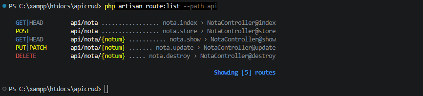

> Nota: en el listado el parámetro aparece como `{notum}` y no como `{nota}`, porque Laravel singulariza el nombre del recurso con las reglas del inglés. No afecta el funcionamiento, ya que el controlador recibe el identificador como argumento `$id`.

### 6.8 Instalación de Thunder Client

Para probar la API se instaló en Visual Studio Code la extensión **Thunder Client**, un cliente REST liviano que cumple la misma función que Postman sin salir del editor. Tras instalarla aparece el icono de rayo en la barra lateral, desde donde se crean las peticiones con **New Request**.

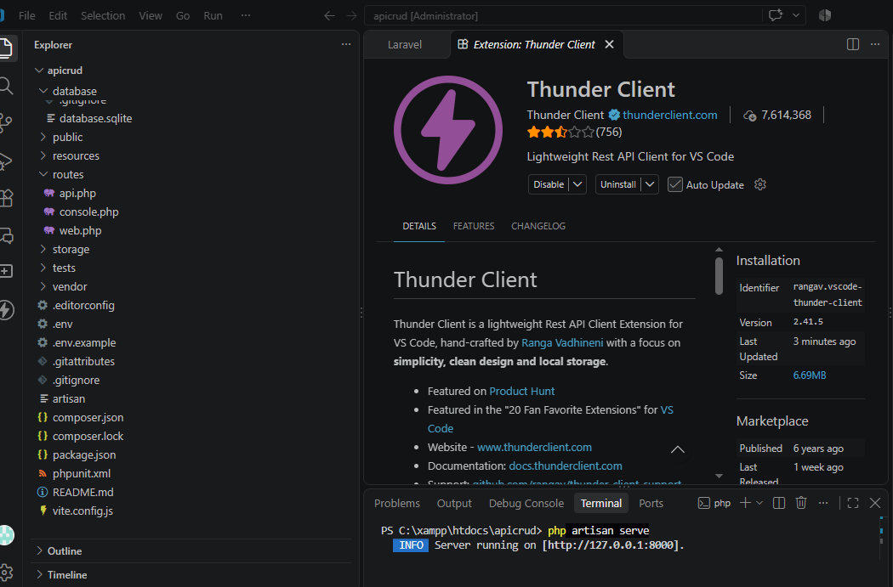

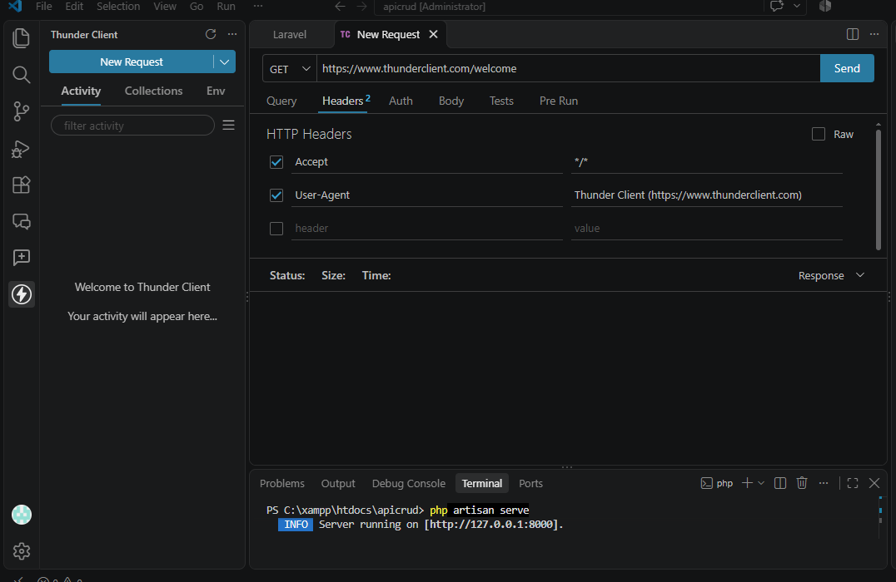

### 6.9 Servidor de desarrollo

Se levantó el servidor de pruebas, que atiende en `http://127.0.0.1:8000` durante todo el proceso. En la terminal se ve el registro de cada petición recibida en `/api/nota`:

```bash
php artisan serve
```

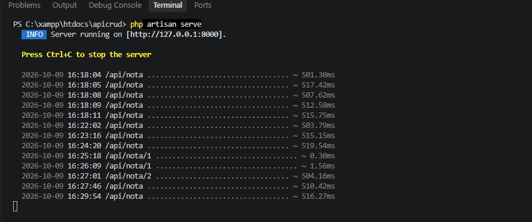

---

## 7. Funcionamiento de la aplicación: pruebas de la API

Todas las pruebas se realizaron en Thunder Client sobre `http://127.0.0.1:8000/api/nota`, enviando el cuerpo (*Body*) en formato JSON. Para la prueba de validación se configuró además el encabezado `Accept: application/json`, necesario para que Laravel devuelva la respuesta de validación en JSON en lugar de redirigir.

| N.° | Operación | Método y URL | Resultado esperado | Resultado obtenido |
|---|---|---|---|---|
| 1 | Crear nota 1 | `POST /api/nota` | 201 Created | ✓ 201 |
| 2 | Crear nota 2 | `POST /api/nota` | 201 Created | ✓ 201 |
| 3 | Listado | `GET /api/nota` | 200 OK con 2 notas | ✓ 200 |
| 4 | Edición | `PUT /api/nota/1` | 200 OK | ✓ 200 |
| 5 | Comprobar edición | `GET /api/nota/1` | 200 OK con datos nuevos | ✓ 200 |
| 6 | Borrado | `DELETE /api/nota/2` | 200 OK | ✓ 200 |
| 7 | Comprobar borrado | `GET /api/nota` | 200 OK solo con la nota 1 | ✓ 200 |
| 8 | Validación | `POST /api/nota` con `titulo` vacío | 422 | ✓ 422 |

### 7.1 Crear notas (`POST`)

Body enviado para la primera nota:

```json
{
    "titulo": "Primera Nota",
    "contenido": "esta es la primera nota"
}
```

La API respondió `201 Created` con `{"success": true}`:

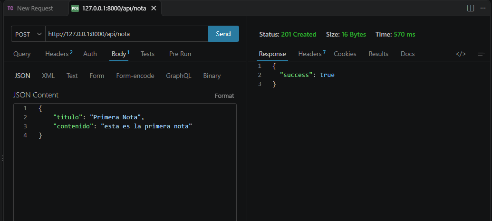

Se repitió con una segunda nota para contar con dos registros:

```json
{
    "titulo": "Segunda Nota",
    "contenido": "esta es la segunda nota"
}
```

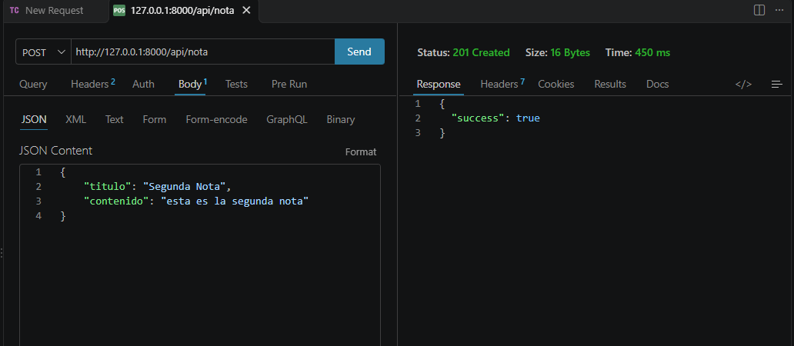

### 7.2 Listado (`GET`)

`GET /api/nota` devolvió `200 OK` con el arreglo JSON de las dos notas, incluyendo `id`, `titulo`, `contenido`, `created_at` y `updated_at`:

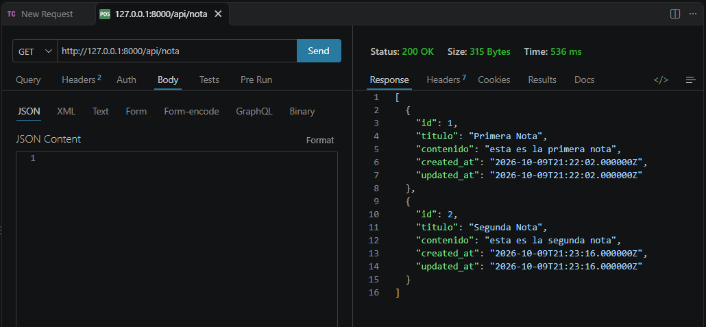

### 7.3 Edición (`PUT`)

`PUT /api/nota/1` con el siguiente body:

```json
{
    "titulo": "Primera Nota editada",
    "contenido": "contenido modificado"
}
```

La API respondió `200 OK`:

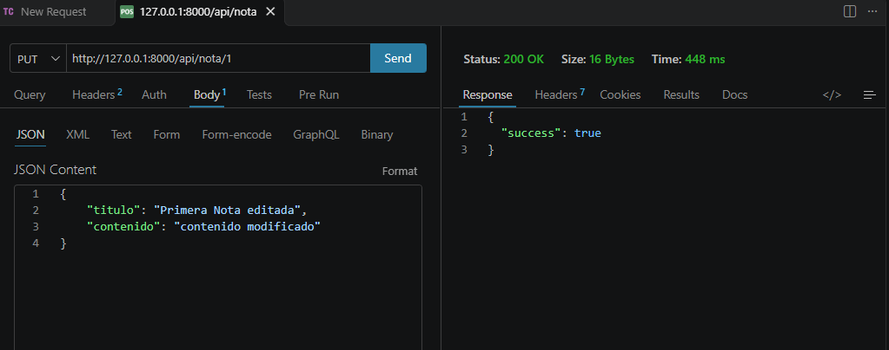

Para comprobar que el cambio se guardó, se consultó la nota con `GET /api/nota/1`: se observa el nuevo título y contenido, y que `updated_at` es posterior a `created_at`:

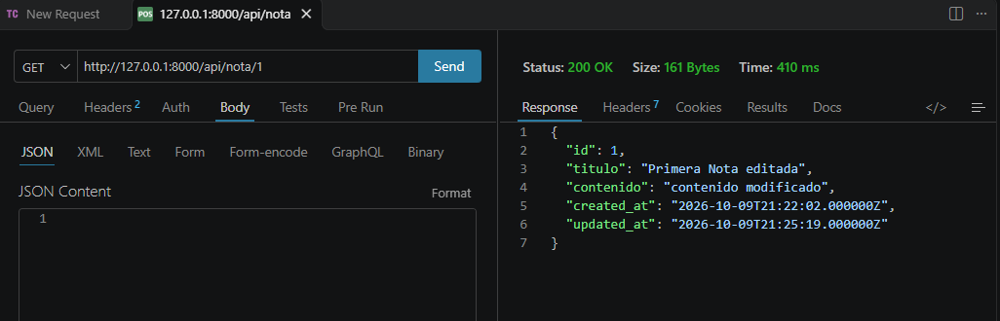

### 7.4 Borrado (`DELETE`)

`DELETE /api/nota/2` respondió `200 OK` con `{"success": true}`:

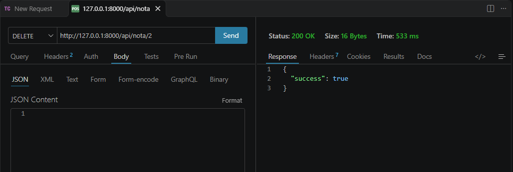

Al volver a consultar el listado, la nota 2 ya no aparece y solo queda la nota 1:

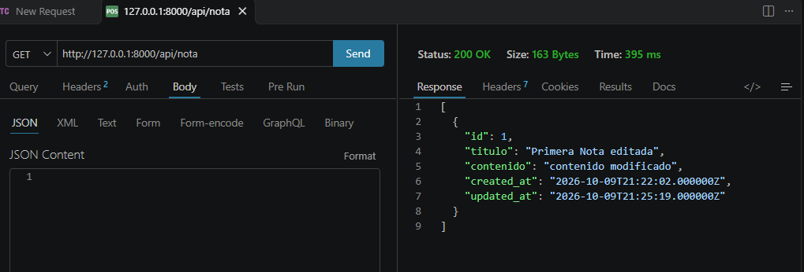

### 7.5 Validación de datos

Se envió un `POST` con el título vacío:

```json
{
    "titulo": "",
    "contenido": "sin titulo"
}
```

`NotaRequest` validó los datos antes de llegar al controlador y la API respondió `422 Unprocessable Content`, indicando que el campo `titulo` es obligatorio. No se guardó nada en la base de datos:

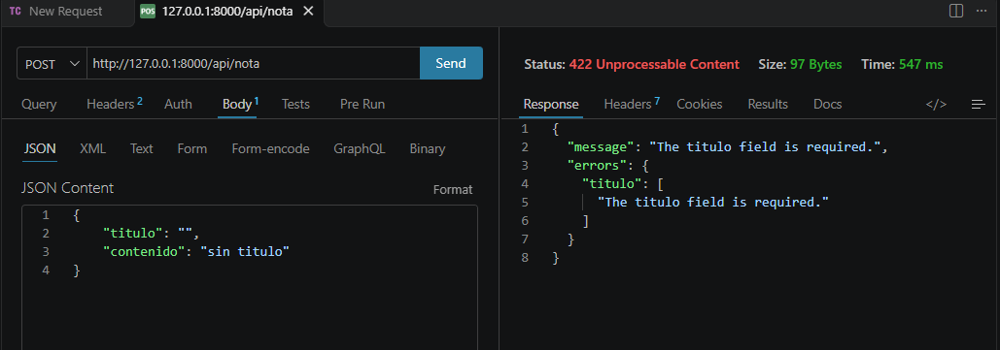

### 7.6 Verificación en la base de datos (phpMyAdmin)

La tabla `notas` de la base de datos `apicrud` contiene un único registro: la nota 1 con el título y contenido editados, confirmando que la edición y el borrado se aplicaron realmente en MySQL:

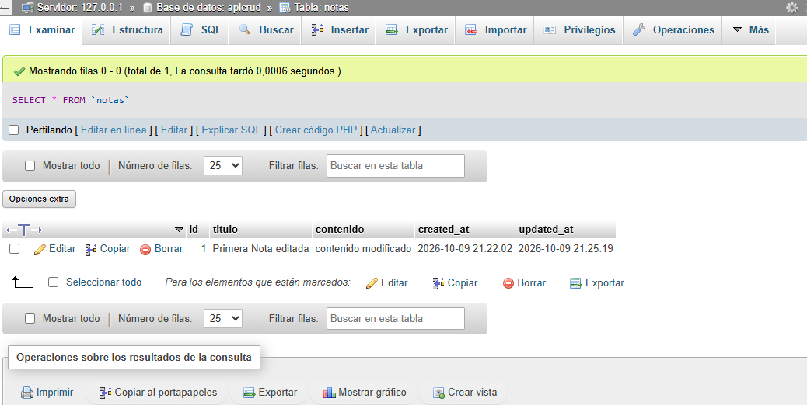

### 7.7 Estructura de la base de datos

Estructura de las tablas de la base de datos `apicrud` (11 tablas). Además de `notas`, creada por la migración de este laboratorio, aparecen las tablas que Laravel genera por defecto (`users`, `cache`, `jobs`, `sessions`, etc.) y `personal_access_tokens`, creada por `php artisan install:api`:

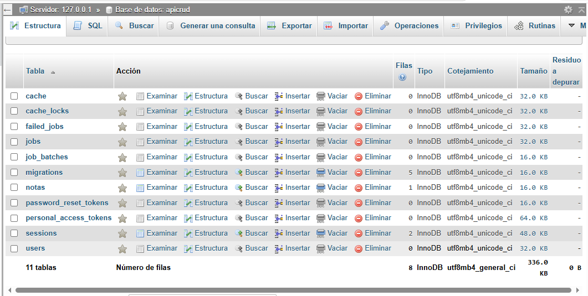

---

## 8. Conclusiones

- Una API REST en Laravel separa por completo el *backend* de la presentación: el mismo servicio puede ser consumido por cualquier frontend (Angular, React, móvil) porque solo intercambia JSON.
- El controlador de recurso (`make:controller --resource`) junto con `Route::apiResource` permite obtener las cinco operaciones del CRUD con una sola línea de rutas, evitando definir cada endpoint a mano.
- En una API sobran los métodos `create()` y `edit()`, pensados para mostrar formularios: la creación se resuelve con `store()` y la edición con `update()`.
- Mover las reglas de validación a `NotaRequest` mantiene el controlador limpio y garantiza que ninguna operación se ejecute con datos inválidos; la API responde con `422` y el detalle de los campos inválidos.
- Devolver el código de estado HTTP correcto en cada caso (`200`, `201`, `404`, `422`) es parte del contrato de la API, ya que el cliente depende de ese código para saber el resultado de su petición.
- La verificación de existencia de la nota permite responder con un `404` claro cuando se consulta, edita o borra un identificador que no existe.
- Registrar `routes/api.php` en `bootstrap/app.php` habilita el grupo de rutas con prefijo `api`, que se verifica con `php artisan route:list`.
- Thunder Client resultó una alternativa práctica a Postman, al permitir probar los endpoints sin salir de Visual Studio Code.

---

## 9. Repositorio

Código fuente completo disponible en este repositorio de GitHub.
